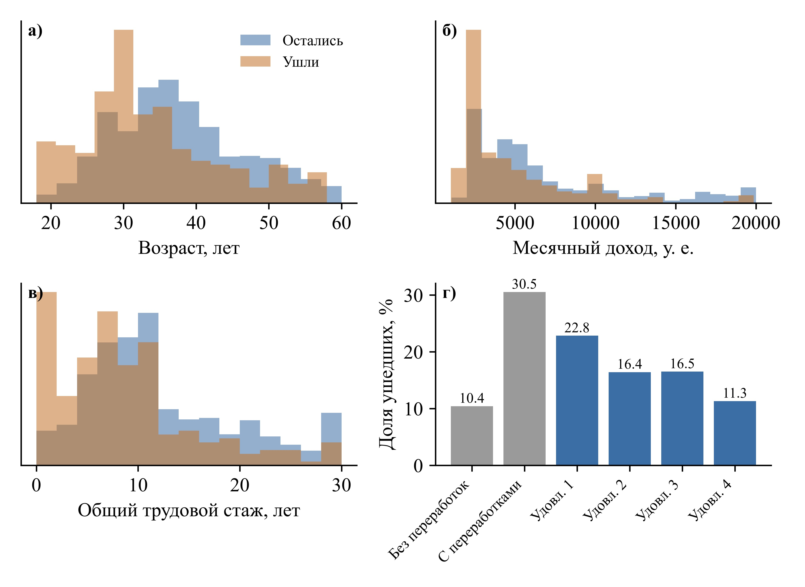
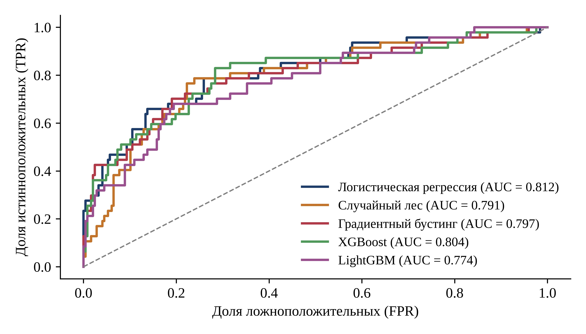
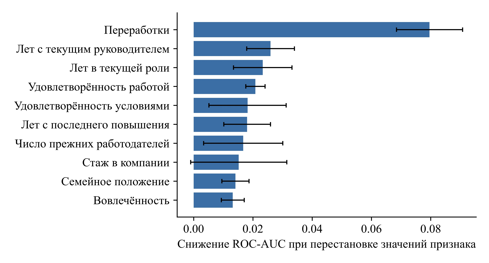
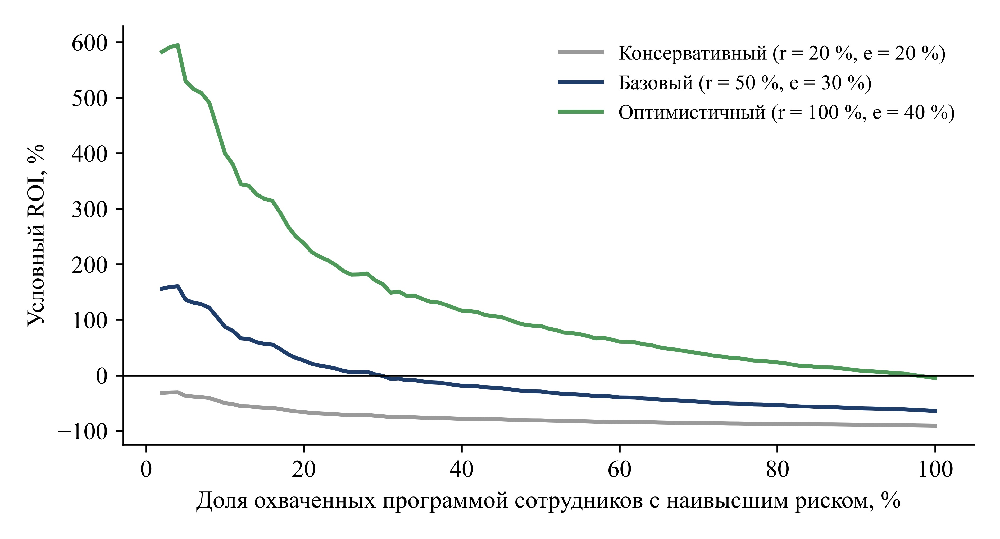

# Прогнозирование текучести кадров методами машинного обучения

Воспроизводимое исследование к научной статье «Машинное обучение в прогнозировании текучести кадров в управлении человеческим капиталом организации».

Цель: на открытом датасете IBM построить модель прогноза увольнения сотрудника, сравнить несколько классических ML-моделей, выявить ключевые факторы оттока и оценить экономический эффект программы удержания.

## Данные

[IBM HR Analytics Employee Attrition & Performance](https://github.com/IBM/employee-attrition-aif360): 1470 сотрудников, 35 признаков, доля увольнений 16,1 %. Набор вымышленный, подготовлен специалистами IBM. Копия лежит в `data/emp_attrition.csv`.

## Что сделано

1. Первичный анализ и подготовка признаков, сравнение ушедших и оставшихся.
2. Сравнение пяти моделей: логистическая регрессия, случайный лес, градиентный бустинг (scikit-learn), XGBoost, LightGBM. Дисбаланс классов учтён весами, без синтетических данных.
3. Доверительные интервалы AUC (бутстрэп, 2000 повторов) и кросс-валидация 5×3.
4. Проверка модели без защищённых признаков (возраст, пол, семейное положение).
5. Факторы оттока: перестановочная важность признаков.
6. Экономическая оценка программы удержания (ROI) в трёх сценариях.

## Основные результаты

| Модель | AUC на тесте | 95 % ДИ | AUC в CV 5×3 |
|---|---|---|---|
| Логистическая регрессия | 0,812 | 0,735–0,882 | 0,829 ± 0,031 |
| Случайный лес | 0,791 | 0,713–0,860 | 0,800 ± 0,033 |
| Градиентный бустинг | 0,797 | 0,715–0,872 | 0,806 ± 0,027 |
| XGBoost | 0,804 | 0,722–0,878 | 0,816 ± 0,029 |
| LightGBM | 0,774 | 0,689–0,847 | 0,810 ± 0,036 |

- Логистическая регрессия показала лучший AUC, но интервалы моделей сильно пересекаются (в тесте всего 47 уволившихся), поэтому строгое ранжирование статистически не обосновано.
- Главный фактор оттока: переработки (снижение AUC при перестановке 0,080, это в 3 раза больше следующего фактора).
- Без возраста, пола и семейного положения качество почти не падает (OOF AUC 0,827 → 0,821).
- Среди 10 % сотрудников с наивысшим риском оказывается 43 % всех уволившихся. Программа удержания окупается в базовом и оптимистичном сценариях при узком охвате и убыточна при охвате всех сотрудников.

## Графики






## Структура

```
notebooks/attrition_research.ipynb   анализ целиком
data/emp_attrition.csv               датасет
images/                              рисунки из статьи
requirements.txt                     зависимости
```

## Запуск

```bash
pip install -r requirements.txt
jupyter notebook notebooks/attrition_research.ipynb
```

Случайные процессы зафиксированы (`SEED = 42`). Если файла данных рядом с ноутбуком нет, он скачается из репозитория IBM автоматически.

> **Важно:** нужен `xgboost >= 2.1.4`. Старые версии несовместимы со scikit-learn ≥ 1.6: оценки XGBoost в кросс-валидации и подборе параметров молча превращаются в `NaN`. В ноутбуке стоит проверка версии, и ошибки не подавляются (`error_score="raise"`).

## Стек

Python, pandas, NumPy, SciPy, scikit-learn, XGBoost, LightGBM, Matplotlib.
